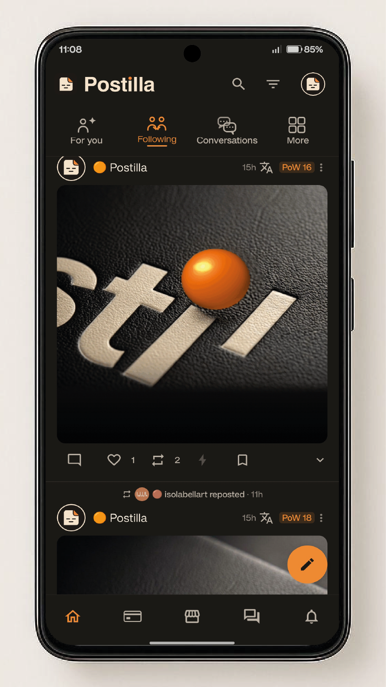
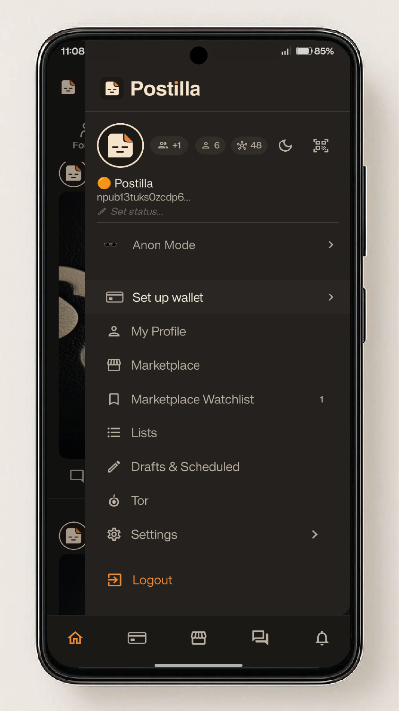
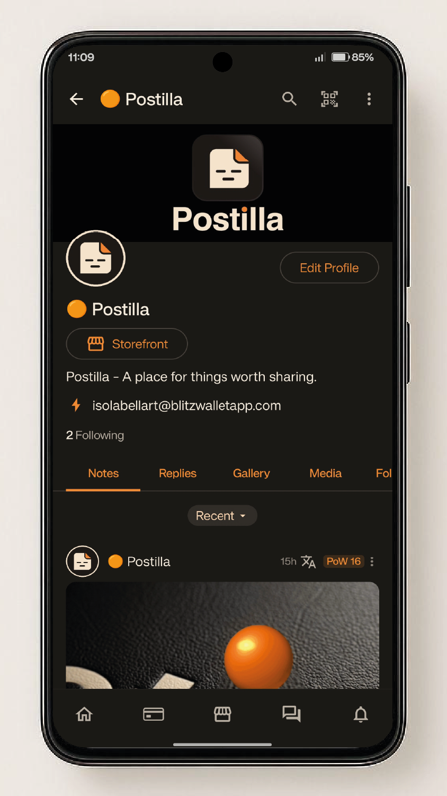
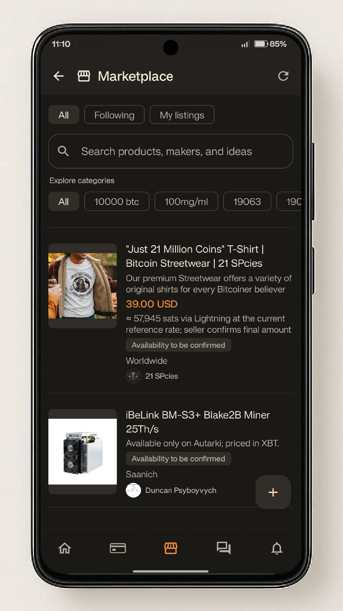
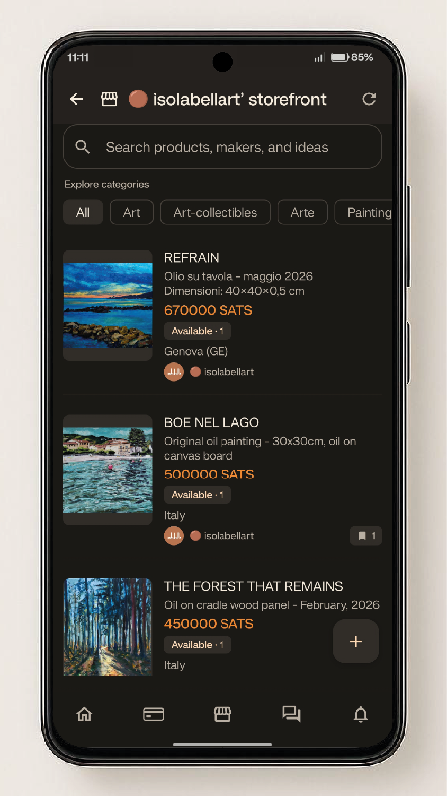
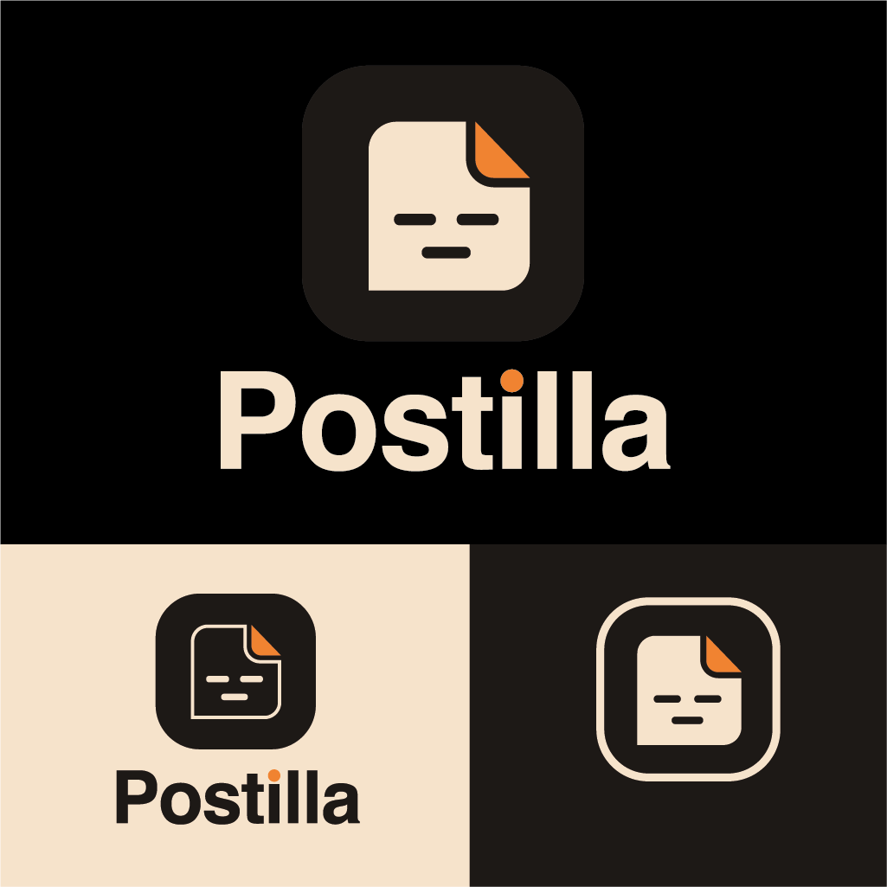

# Postilla

<p align="center"><strong>A place for things worth sharing.</strong></p>

<p align="center">
  An independent, open-source Android Nostr client for social conversations, private messaging, Lightning and a community-powered marketplace.
</p>

<p align="center">
  <a href="https://github.com/isolabellart/postilla-android">Source code</a> ·
  <a href="https://github.com/isolabellart/postilla-android/releases">Releases</a> ·
  <a href="https://github.com/barrydeen/dark-wisp-android">Original Dark Wisp project</a>
</p>

> **Project status — 14 November 2026:** Postilla is the new public identity of the independently maintained Dark Wisp Enhanced codebase. The latest verified staging build is **#184**. The current source configuration is still version **1.0.10 (version code 11)**; the planned public Postilla release is **v1.0.15**. It has not been published yet. The existing stable release remains the previous Dark Wisp Enhanced v1.0.10 release until the new signed release is explicitly prepared and published.

Postilla is a downstream project built on the foundations of the original [Dark Wisp Android client](https://github.com/barrydeen/dark-wisp-android). It is independently maintained and is **not an official release of the upstream project**.

The project aims to bring together the human side of Nostr — publishing, conversation, discovery and exchange — in one native Android application, while keeping users in control of their identity, keys, relays and funds.

---

## Postilla in screenshots

A glimpse of Postilla's Android experience, from social conversations to discovery and exchange.

<p align="center">
  
  
  
  
  
</p>

## The Postilla visual identity

Postilla's visual identity brings together a calm editorial character, warm ivory, deep charcoal and a restrained orange accent.

<p align="center">
  
</p>

---

## Why Postilla

Nostr is more than a social feed. It is a network of people, independent relays, communities, media, private conversations and open protocols.

Postilla is being developed around five goals:

1. **Make Nostr approachable.** Present powerful protocol features through a coherent, native and accessible mobile experience.
2. **Keep the network decentralized.** Respect users' relay choices and use outbox/inbox routing instead of depending on a single central service.
3. **Protect identity and privacy.** Give users control over signing, encryption, account data and private conversations.
4. **Make exchange native to Nostr.** Bring discovery, seller storefronts, NIP-99 listings and Lightning interactions into the same application.
5. **Build for everyday reliability.** Handle slow or unavailable relays, duplicate events, historical addressable content and interrupted network connections carefully.

The Postilla visual identity follows the same intention: a calm editorial space, with warm ivory, deep charcoal and a restrained orange accent.

---

## Features

### Social publishing and discovery

- Nostr home feeds and profile timelines.
- Short-form notes (NIP-01) and long-form articles (NIP-23).
- Picture-first posts (NIP-68) and video posts (NIP-71), including media metadata and previews.
- Reposts (NIP-18), emoji reactions (NIP-25) and custom emoji (NIP-30).
- Reply threads with root/reply resolution (NIP-10).
- Poll creation and voting (NIP-88), plus zap-poll support (NIP-69).
- Hashtag feeds, hashtag following, profile and content search.
- Bookmarks, pins, mute lists and custom follow sets (NIP-51).
- Notifications for relevant social activity.
- Drafts saved as Nostr events (NIP-37).
- Profile editing, NIP-05 verification and QR sharing for profiles and keys.

### Private messaging

- **NIP-17 private direct messages** using the gift-wrap model (rumor, seal and gift wrap).
- **NIP-44 encryption** for modern private messaging.
- Legacy NIP-04 message reading for backward compatibility.
- Dedicated private-message relay preferences using NIP-17/NIP-51 kind 10050, separate from public posting relays.
- Optional encrypted media attachments.
- Optional **Amber / NIP-55 remote signing**, so private keys can remain in a dedicated signer application.
- Conversation translation with DeepL, available on request; the original Nostr message remains unchanged.
- Marketplace-related conversations can retain a reference to the listing being discussed.

### NIP-99 Marketplace

Postilla includes a native Marketplace built around NIP-99 addressable product listings (kind 30402).

- Browse marketplace listings and discover seller storefronts from profiles.
- Search listings and filter by category.
- Explore all listings, listings from followed accounts, or the current user's own listings.
- Open product details using stable NIP-99 coordinates (kind, author and `d` identifier).
- Resolve addressable listings and their revisions without treating every revision as a different product.
- Publish NIP-99 listings from the Android app.
- Display seller identity and listing availability information.
- Add listings to a personal watchlist/bookmark set and show available interest information.
- React to listings and send Lightning Zaps.
- Open referenced listings from relevant Marketplace conversations.

**Marketplace development objective:** Postilla aims to evolve this into a complete merchant workspace. Planned improvements include a more comprehensive personal listing inventory, clearer active/withdrawn/sold states, safer editing and reactivation of historical listings, and more tools for sellers to maintain their catalogue. These management improvements must be considered roadmap items until they are implemented and verified in a release.

### Lightning and payments

- Embedded, self-custodial Lightning wallet powered by Breez SDK Spark.
- NWC (NIP-47) as an alternative connection to compatible external wallets.
- Lightning address support where configured.
- Send and receive Lightning payments, scan or import invoices and view transaction history.
- Nostr Zaps (NIP-57), zap receipts and zap-enabled social interactions.
- Wallet backup and restore flows; supported wallet backup data is encrypted before being published to the user's Nostr relays.

Wallet recovery material is sensitive. Never share a recovery phrase, private key, wallet secret or NWC connection string with anyone.

### Relay intelligence and network reliability

Postilla is designed to use Nostr's decentralized relay model rather than assuming that every user publishes everything to the same servers.

- **NIP-65 outbox/inbox relay lists** for author-aware reads and recipient-aware delivery.
- Relay scoring and author-coverage information to select useful relays for queries.
- Persistent and temporary relay connections, with lifecycle management and idle cleanup.
- Relay health information, failure cooldowns and reconnect handling.
- NIP-11 relay information and capability discovery.
- NIP-42 relay authentication, with explicit user-approved relay access.
- Relay hints and addressable-event lookup to improve event discovery.
- Separate relay preferences for private messages and Blossom media services.

Relay availability and event retention remain properties of the decentralized network. No client can guarantee that an event will be retrievable if every relay that stored it has removed it and the device has no local copy.

### Media and Blossom

- Upload and retrieve media through decentralized Blossom servers.
- Per-account Blossom server configuration (NIP-51 kind 10063).
- Nostr-based upload authentication (kind 24242).
- Multiple configured servers can be used as alternatives when an upload fails.
- Image and video rendering through Coil and Android Media3.

### Groups and live activity

- Relay-based NIP-29 groups, including discovery, membership and group messaging.
- Live activities and streams (NIP-53).
- Group data and recent messages are cached locally to improve responsiveness.

### Privacy, safety and account control

- Multiple Nostr accounts.
- Local private-key storage protected by Android encrypted storage.
- Biometric protection for sensitive key access where supported by the device.
- NIP-55 remote signing through Amber or another compatible signer.
- NIP-51 mute lists, blocked pubkeys, keyword muting and blocked-relay lists.
- Optional social-graph filtering.
- On-device spam classification, designed to evaluate content without sending it to a remote classifier.
- NIP-19 Bech32 identifiers and `nostr:` URI handling.
- NIP-05 DNS identity verification.

### Translation and accessibility

- DeepL translation integration with configurable language preferences.
- On-demand translation in conversations, with the ability to return to the original text.
- Ongoing work on readable layouts, touch targets, localization and a consistent light/dark appearance.

---

## Supported Nostr protocols

The following table reflects protocol implementations and integrations present in the current codebase. Support may vary by event type and by the capabilities of connected relays and other clients.

| NIP / protocol | Purpose |
|---|---|
| NIP-01 | Basic protocol and event model |
| NIP-02 | Follow lists |
| NIP-04 | Legacy encrypted DMs (compatibility reading) |
| NIP-05 | DNS-based identity verification |
| NIP-09 | Event deletion |
| NIP-10 | Reply threading |
| NIP-11 | Relay information document |
| NIP-13 | Proof of Work |
| NIP-17 | Private direct messages (gift wrap) |
| NIP-18 | Reposts |
| NIP-19 | Bech32 identifiers |
| NIP-23 | Long-form content |
| NIP-25 | Reactions |
| NIP-29 | Relay-based groups |
| NIP-30 | Custom emoji |
| NIP-37 | Draft events |
| NIP-42 | Relay authentication |
| NIP-44 | Versioned encryption |
| NIP-47 | Nostr Wallet Connect |
| NIP-51 | Lists, bookmarks, mute lists and relay sets |
| NIP-53 | Live activities |
| NIP-55 | Android remote signer |
| NIP-57 | Lightning Zaps |
| NIP-65 | Relay list metadata / outbox model |
| NIP-68 | Picture-first posts |
| NIP-69 | Zap polls |
| NIP-71 | Video events |
| NIP-78 | Application-specific data |
| NIP-88 | Polls |
| NIP-99 | Classified listings / Marketplace |

Additional integrations include Blossom media servers, Lightning invoices (BOLT-11), Breez SDK Spark and Nostr Wallet Connect.

---

## Architecture

Postilla is a native Android application written in Kotlin and built with Jetpack Compose. Its architecture separates the presentation layer, state holders, repositories, protocol implementations and relay transport.

```text
Jetpack Compose UI
        |
ViewModels and coordinators
        |
Repositories, caches and local persistence
        |
Nostr protocol implementations and signer abstraction
        |
Relay pool, outbox router and WebSocket connections
```

### Main engineering principles

- **MVVM and Kotlin coroutines:** ViewModels expose reactive state through StateFlow and SharedFlow.
- **Protocol-focused code:** NIP implementations are separated into small Kotlin components.
- **Signer abstraction:** local signing and NIP-55 remote signing use the same application-facing interface.
- **Background work:** network requests, event processing and cryptographic work avoid blocking the main thread.
- **Selective local persistence:** ObjectBox is used for selected event types and application data; sensitive key material is kept in protected storage.
- **Relay-aware event handling:** deduplication, relay scoring, event-address resolution and reconnect handling are treated as core infrastructure.
- **Testable protocol logic:** pure helpers and repository behaviour are covered by unit tests where practical.

### Technology stack

| Area | Technology |
|---|---|
| Language | Kotlin |
| UI | Jetpack Compose / Material 3 |
| Async and state | Kotlin Coroutines / Flow |
| Networking | OkHttp WebSockets |
| Serialization | kotlinx.serialization |
| Images | Coil |
| Video and audio playback | Android Media3 |
| Local event persistence | ObjectBox |
| Key protection | Android Security Crypto |
| Cryptography | secp256k1, Bouncy Castle and JCA |
| Lightning | Breez SDK Spark and NWC |
| Translation | DeepL integration |
| QR codes | ZXing |
| Build | Gradle / Android Gradle Plugin |

---

## Installation and upgrade continuity

Postilla continues the existing Dark Wisp Enhanced Android installation line. This is intentional.

| Setting | Value |
|---|---|
| Android application ID | `com.isolabellart.darkwispenhanced` |
| Staging application ID | `com.isolabellart.darkwispenhanced.staging` |
| Minimum Android version | Android 8.0 (API 26) |
| Target Android SDK | 35 |
| Current source version | 1.0.10 (version code 11) |
| Planned public Postilla release | 1.0.15 |
| Current verified staging build | #184 |

The application ID and permanent signing certificate are deliberately preserved. This allows a properly signed Postilla APK to update an existing Dark Wisp Enhanced installation, rather than creating a second Android app. Android will accept the update only when the package identity, version progression and signing certificate are compatible.

The staging workflow verifies the application ID and the permanent signing certificate. The latest verified build at the time of writing is [staging #184](https://github.com/isolabellart/postilla-android/actions/runs/43578605677).

**Important:** the planned v1.0.15 release is not yet available. Until the final signed APK has passed validation and has been published, the current stable release remains the previous Dark Wisp Enhanced v1.0.10. Do not uninstall the existing application to install a test build unless you have independently verified your account and wallet recovery procedures.

### Wallet and account safety

- Keep Nostr recovery phrases and wallet recovery material offline.
- Never share an `nsec`, wallet seed, password or NWC connection string.
- Consider using Amber or another NIP-55 signer to keep your Nostr private key outside Postilla.
- A new installation or a device replacement may require the normal account and wallet restore process. Do not assume that a Nostr identity automatically restores local application data.

---

## Build from source

### Requirements

- Android Studio with a recent Android Gradle Plugin-compatible toolchain.
- JDK 17.
- Android SDK 35.
- Git.

### Clone

```bash
git clone https://github.com/isolabellart/postilla-android.git
cd postilla-android
```

### Build and test

```bash
# Run unit tests for the staging variant
./gradlew testStagingUnitTest

# Build a debug APK
./gradlew assembleDebug

# Build the staging APK
./gradlew assembleStaging

# Build the release APK (a local signing configuration is required
# for a signed release APK)
./gradlew assembleRelease
```

Release signing material is never stored in the repository. See [RELEASE_SIGNING.md](RELEASE_SIGNING.md) for the permanent signing identity, GitHub Actions configuration and release procedure. Do not generate a replacement keystore for the existing application line.

---

## Roadmap

Postilla is an evolving project. The following goals guide future development and must not be mistaken for features already shipped.

- **Marketplace management:** a complete personal inventory of the user's NIP-99 listings, including historical listings, revisions and clear publication status.
- **Safer listing lifecycle:** predictable edit, withdraw, archive and reactivation flows that respect NIP-99 addressable-event identity and NIP-09 deletion semantics.
- **Better commerce workflows:** clearer buyer/seller conversations, order context and payment status, while keeping the Nostr protocol interoperable.
- **Relay resilience:** broader relay coverage, smarter fallback strategies, better diagnostics and reliable recovery from interrupted connections.
- **Social experience:** continued refinement of threads, reactions, bookmarks, notifications and media handling.
- **Privacy and user control:** expand remote-signer support, minimize unnecessary data collection and keep sensitive operations transparent.
- **Quality and accessibility:** more automated tests, manual device testing, improved localization and accessible interaction patterns.

The long-term objective is a dependable Nostr client in which social publishing and real-world exchange can coexist without giving up decentralization or user control.

---

## Contributing

Contributions, bug reports and focused improvements are welcome.

1. Fork the repository or create a feature branch.
2. Keep changes scoped and describe the motivation.
3. Add or update tests for protocol and state-management changes.
4. Run the relevant Gradle tests and build tasks.
5. Test user-facing changes on a real Android device when possible.
6. Open a pull request with a concise summary and validation notes.

Suggested branch prefixes: `feat/`, `fix/`, `refactor/`, `docs/`, `test/` and `chore/`.

---

## Project lineage and license

Postilla is an independent downstream fork of [Dark Wisp for Android](https://github.com/barrydeen/dark-wisp-android). It is not affiliated with, endorsed by or an official release of the upstream project.

The project retains the upstream [MIT License](LICENSE) and its original copyright notice. See the license file for the complete terms.

---

<p align="center"><strong>Built with care for the Nostr ecosystem.</strong></p>
