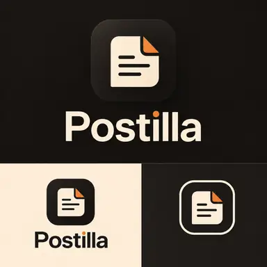

# Postilla — visual identity

## Brand idea

Postilla is an editorial, human social space. A post is a small note left for others;
a marketplace listing is another thing worth sharing. The interface should feel like a
modern independent publication, not a technical Nostr dashboard.

## Official presentation board

The board is the reference for the current Postilla face mark and wordmark. It supersedes
the earlier paper-note symbol approved during staging #155.

## Mark

The mark is a small ivory note with a simple, recognizable face: two short horizontal
eyes and one shorter mouth, with an orange folded corner. It sits on a flat, dark,
rounded square. Preserve the proportions and the quiet expression; do not turn the
features back into generic text lines or add details.

The Android vector source is `app/src/main/res/drawable/postilla_mark.xml`.
The adaptive launcher foreground uses the same geometry.

## Wordmark

Use the extracted vector wordmark in
`postilla_wordmark_light.xml` on dark surfaces and
`postilla_wordmark_dark.xml` on light surfaces, through `PostillaWordmark`.
The letters and orange dot are traced from the supplied presentation artwork. Do not
rebuild the name with a Text composable, add letter spacing, or substitute a system font.

## Palette

The interface continues to use the established two appearances.

| Role | Light | Dark |
|---|---|---|
| Background | Ivory #F4EBDD | Ebony #1B1916 |
| Raised surface | #FFFAF1 | #24211E |
| Inset surface | #EAE1D3 | #302C27 |
| Primary text | Ebony #1B1916 | Ivory #F4EBDD |
| Secondary text | #6C645A | #B8AEA1 |
| Accent | #A65318 | #F08A32 |

The supplied logo artwork has its own exact extracted values: face ivory #F6E3CB,
dark ink #1D1916 and orange #F08331. Keep those values within the logo assets; do not
silently recolor or distort the artwork to match UI text.

No purple, alternate colour themes, gradients, glows or ornamental shadows.
Orange is reserved for selected navigation, focus, small state cues and important actions.

## Typography

Use the native sans-serif system family for application text. Keep a clear scale,
generous line height and restrained weights. Do not bundle a web font or block first
paint to load typography. The Postilla wordmark is an exception: it is an extracted
brand asset, not live interface text.

## Layout and interaction

- Use editorial hierarchy, quiet dividers and whitespace instead of nested cards.
- Keep primary touch targets at least 48 dp and give icons breathing room.
- Prefer labels where they improve navigation; do not cram controls into the top bar.
- Drawer and popup motion should be short and calm, with flat ebony/ivory surfaces and
  a restrained orange active state.
- Images and event content must load independently of ornamental UI work.

## Implementation rule

This branch is a visual redesign. Preserve Nostr event semantics, signing, relay behaviour,
persistence and Marketplace data paths while the presentation changes.
